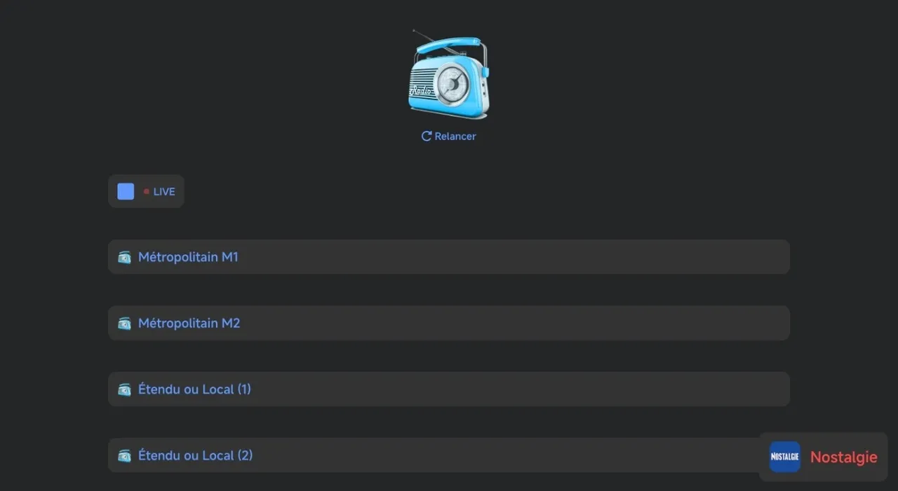

# Radios by Le Site de Flo sur Android TV

[](https://github.com/FloMarl69/radios-flo-tv/releases)
[](#compatibilité)
[](https://github.com/FloMarl69/radios-flo-tv/releases)
[](https://github.com/FloMarl69/radios-flo-tv/releases)

**Application Android TV / Google TV (Android 7+) permettant d’écouter 132 radios francophones en direct, gratuitement et sans inscription, avec une navigation pensée pour la télécommande.** Elle donne un accès direct à la plateforme <a href="https://lesitedeflo.floinfo38.com" target="_blank" rel="noopener noreferrer">Radios by Le Site de Flo</a> depuis votre Smart TV, clé HDMI, Chromecast ou box TV Android.

## Avantages

- Lecteur de radios françaises très léger, peut-être le plus léger de France, codé à la main.
- Les flux radios sont soigneusement sélectionnés pour une bonne qualité d'écoute.
- Aucun traceur ni script tiers de ma part, pas de publicité ajoutée (les radios peuvent diffuser la leur).

**Pour installer Radios Flo sur ordinateur, smartphone ou tablette, veuillez installer l'appli PWA disponible directement depuis le site web.**

<br>
<p align="center"></p>
<br>

## Ce que permet l'application

132 stations réparties en 11 catégories inspirées du DAB+, à parcourir comme un carrousel :

| Catégorie | Stations |
|---|---|
| Métropolitain M1 et M2 | 26 radios nationales : NRJ, RTL, France Inter, Europe 1, Nostalgie, Skyrock, FIP, RMC… |
| Étendu ou Local (1 et 2) | 19 radios étendues ou locales : Alpes 1, Sud Radio, TSF Jazz, Virgin Radio… |
| Ici (1, 2 et 3) | 45 radios régionales du réseau « Ici » |
| Locales FM et Autres Pays | 5 radios locales et d'autres pays |
| Webradios | 14 webradios : rock, rap, reggae, classiques… |
| 100 % Artistes (1 et 2) | 23 radios dédiées à un artiste ou un groupe |

- Écoute en direct, lancement d'une radio en un appui sur OK.
- Retour automatique du son après une coupure du réseau.
- La dernière radio écoutée est mémorisée.
- Touches média de la télécommande (lecture, pause, stop).
- L'écran reste allumé pendant l'écoute.
- Le volume se règle avec la télécommande de la TV.
- La gestion des sessions multimédias et de la fonctionnalité de chargement d'illustrations dans la carte « Lecture en cours » de l'écran d'accueil ou dans le panneau multimédia.

Une connexion Internet est nécessaire. Les flux sont ceux des diffuseurs ; l'application ne les héberge pas.

## Installer

1. Télécharger `radios-flo.apk` depuis la [page des releases](https://github.com/FloMarl69/radios-flo-tv/releases).
2. Sur la TV, activer le mode développeur (`Paramètres > Système > À propos`, 7 appuis sur « Build »), puis le débogage USB/ADB.
3. Depuis un ordinateur sur le même réseau :

```bash
adb connect IP_DE_LA_TV:5555
adb install -r --user 0 radios-flo.apk
```

Sans ordinateur : application « Downloader » sur la TV avec le code 9678435. Veuillez activer les sources inconnues. L'icône **Radios Flo** apparaît ensuite parmi les applications de l'accueil.

## Télécommande

| Zone | Touches |
|---|---|
| Lecteur | flèches pour passer de la radio au bouton Stop, OK pour relancer ou arrêter |
| Titre de catégorie | → déplier, ← replier, ↓ entrer dans le carrousel |
| Carrousel | ←/→ faire tourner, OK écouter, ↑ revenir au titre |
| Retour | replie la catégorie, remonte au lecteur, double appui pour quitter |
| Touches média | lecture/pause, stop |

## Compatibilité

- Android TV / Google TV / Box Android TV, Android 7.0 (API 24) ou plus, avec « Android System WebView » à jour.
- Testée sur des TV Xiaomi + Freebox Pop. Conçue pour la TV, mais installable aussi sur téléphone (veuillez tout de même privilégier l'appli PWA disponible directement depuis le site web).

## Avertissement et licence

- **Les noms, logos et flux audio des stations appartiennent à leurs ayants droit.** L'application ne retransmet aucun flux : elle se connecte aux adresses publiques des diffuseurs.
- Application © 2026 [Flo Info 38](https://www.floinfo38.fr).
- Politique de confidentialité : <https://www.floinfo38.fr/politique-de-confidentialite>

Un bug, une radio à proposer ? Ouvrez une *issue*.
